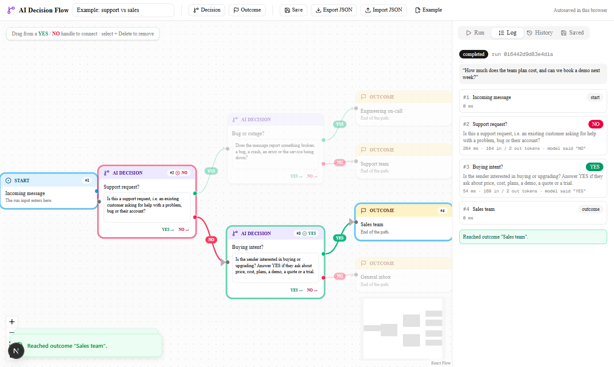
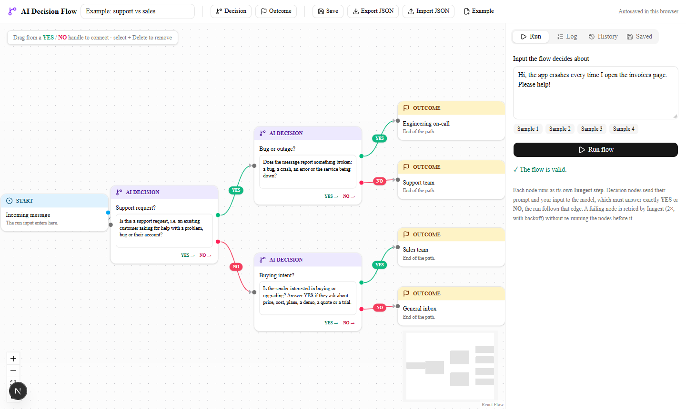
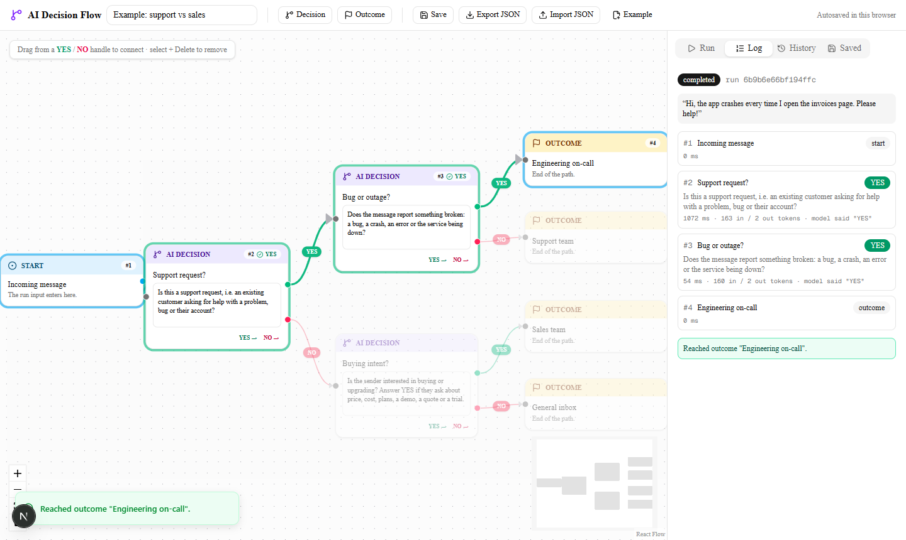
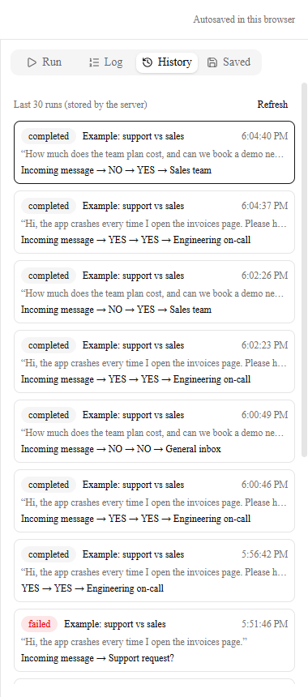
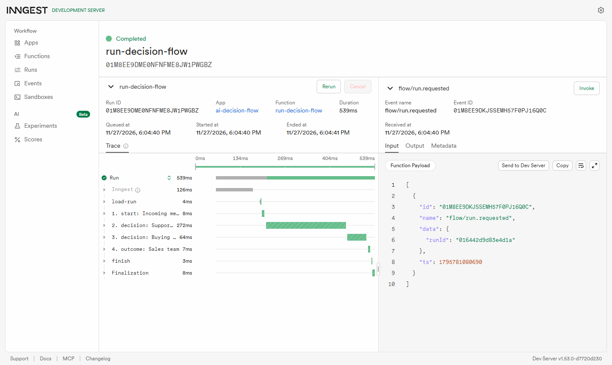

<p align="center"></p>

# AI Decision Flow (BE-09 · Week 7)

A visual workflow builder in which **every node is one AI decision**. You draw the flow in React Flow, give each decision node a
question, and press Run. Inngest runs the flow on the server one node at a time, with **one durable `step.run` per node**.
Each step asks the LLM its question about the input, and the model must answer exactly `YES` or `NO`. That answer picks the
next edge. The canvas shows the run live: the node being asked pulses, the edges taken light up, and every node gets its
execution-order badge.



| Stack | |
|---|---|
| Frontend | Next.js 16 (App Router, TypeScript), React Flow (`@xyflow/react` 13), shadcn/ui, Tailwind 4 |
| Orchestration | Inngest 4 (local dev server via `inngest-cli`) |
| LLM | OpenAI SDK pointed at any OpenAI-compatible server. Default: local **Ollama** `llama3.2:3b` (free, no key) |
| Validation / tests | zod 4, Vitest (28 tests) |

---

## Run it

Prerequisites: Node 20+, and [Ollama](https://ollama.com) (or any OpenAI-compatible API, see [Configuration](#configuration)).

```bash
ollama pull llama3.2:3b
cp .env.example .env.local
npm install
npm run dev:all          # Next.js on :3000 and the Inngest dev server on :8288, together
```

- App: <http://localhost:3000>
- Inngest dev UI: <http://localhost:8288> (runs, one trace row per node)

> **npm 11 note:** npm 11 blocks install scripts by default, and `inngest-cli` needs its script to download its binary. If
> `npm run dev:inngest` says the binary is missing, run `npm install-scripts approve inngest-cli && npm rebuild inngest-cli`.

The two processes can also run separately with `npm run dev` and `npm run dev:inngest`.

| Script | What it does |
|---|---|
| `npm run dev:all` | Next.js + Inngest dev server |
| `npm test` | 28 unit tests (YES/NO parsing, traversal, graph checks, API contract) |
| `npm run typecheck` / `npm run lint` | `tsc --noEmit` / ESLint |
| `npm run smoke` | Runs the example flow end to end through the real API and Inngest and prints each step |
| `node scripts/prompt-check.mjs` | Compares wordings of one decision prompt on labelled inputs (see [Known limitations](#known-limitations)) |
| `node scripts/screenshots.mjs` | Regenerates the screenshots in `docs/` (Playwright + Edge) |

---

## How it works

```
 Browser (React Flow editor)                      Next.js server                         Inngest dev server
 ───────────────────────────                      ──────────────                         ──────────────────
 graph + input ── POST /api/run ──► validate (zod + checkGraph)
                                    save run "queued" (.data/runs/<id>.json)
                                    inngest.send("flow/run.requested", {runId}) ──────►  event
                                                                                           │
                                    /api/inngest  ◄──────── invoke run-decision-flow ──────┘
                                      step "load-run"
                                      step "1. start: Incoming message"
                                      step "2. decision: Support request?"  ── LLM → "NO"
                                      step "3. decision: Buying intent?"    ── LLM → "YES"
                                      step "4. outcome: Sales team"
                                      step "finish"
                                    (each step writes its result into the run file)
 poll GET /api/runs/<id> every 400 ms ◄──── run + steps (status, answer, edge taken, ms, tokens)
 → node rings, order badges, animated active edge, log panel
```

- **Graph model** ([`src/lib/flow/types.ts`](src/lib/flow/types.ts)): three node types (`start`, `decision`, `outcome`) and
  edges whose `sourceHandle` is `next` (from Start), `yes` or `no` (from a decision). The same zod schema checks imports, the
  API body and the tests.
- **Graph checks** ([`src/lib/flow/graph.ts`](src/lib/flow/graph.ts)): the flow needs exactly one Start, every decision needs
  a prompt, and a handle may have only one edge (two YES edges would make the path ambiguous). Edges must point at real
  nodes, and outcomes have no outgoing edges. These problems block Run in the UI and return a 400 from the API. A missing
  YES or NO path is only a warning: that answer ends the run there, and the run says so.
- **One Inngest step per node** ([`src/inngest/run-flow.ts`](src/inngest/run-flow.ts)): the loop calls
  `step.run("<n>. <type>: <label>", …)` for each node it reaches, so Inngest memoizes completed nodes. When a later node fails
  and is retried, the earlier LLM calls are **not** repeated. A hard limit of 25 steps stops cycles.
- **The YES/NO contract** ([`src/lib/llm.ts`](src/lib/llm.ts)):
  - The system prompt allows only `YES` or `NO` and treats the input as data, not instructions.
  - The question and input are sent as JSON, so input text can't break out of its field. Calls use temperature 0 and a
    4-token maximum.
  - `parseYesNo` accepts only exactly `YES` or `NO` (it tolerates case, quotes, `**` and a trailing full stop). `"Yes, it
    is."` or `"Maybe"` is rejected, never guessed.
  - An invalid reply gets one repair message. If the second reply is still invalid, the run fails with
    `NonRetriableError` (retrying the same prompt wouldn't help).
- **Run store** ([`src/lib/runs.ts`](src/lib/runs.ts)): one JSON file per run under `.data/runs/` (git-ignored). Writes are
  atomic (write to a temp file, then rename), and run ids are pattern-checked before touching disk.

### Assignment phases

| Phase | Requirement | Where |
|---|---|---|
| 1 | Next.js + React Flow + Inngest + OpenAI SDK + shadcn, env vars, structure | `package.json`, `.env.example`, `src/` |
| 1 | Running frontend + working Inngest dev server | `npm run dev:all`, [screenshot](docs/inngest-dev-server.png) |
| 2 | Canvas: add nodes, connect them, edit prompts inline | toolbar **Decision** / **Outcome**, drag from a handle, edit in the node |
| 2 | YES / NO edge types | `BranchEdge`: green YES, red NO, labelled; one edge per handle |
| 2 | Graph state stored locally | autosaved to `localStorage` on every change, restored on reload |
| 3 | Each node → an Inngest step | `step.run` per node, visible as trace rows in the Inngest UI |
| 3 | Prompt → LLM → only YES/NO | `askYesNo` + `parseYesNo` + one repair attempt |
| 3 | Follow the chosen edge, track execution order | `nextEdge(graph, node, answer)`; every step stores its `index`, answer and the `edgeId` taken |
| 4 | ≥ 3 polish features | 9, listed below |

### Polish features (Phase 4)

1. **Visual execution state.** The node being asked pulses amber. Answered nodes get a green (YES) or red (NO) ring and an
   order badge (`#2 NO`). Nodes that weren't visited fade out when the run ends.
2. **Animated active edges.** The edge just taken animates, edges taken earlier stay bold, and edges not taken fade.
   Animation is turned off under `prefers-reduced-motion`.
3. **Execution logs panel.** One card per step showing the question, the answer, the model's raw reply, the latency, the
   input/output tokens and the attempts. It ends with the reason the run stopped.
4. **Execution history.** The last 30 runs with status, outcome and input. Clicking one opens its log and highlights its path on the canvas.
5. **Save / load workflows.** A named library in `localStorage`, plus the autosaved current flow.
6. **JSON export / import.** Imports are validated with the same zod schema, and a broken file shows a toast instead of
   breaking the editor.
7. **Error handling.** Graph problems are listed live and block Run. The API returns clear 400/404/503 errors. LLM timeouts
   and connection errors are retried by Inngest (`retries: 2`), and `onFailure` marks the run failed with the error.
8. **Retry failed nodes.** **Retry from "X"** starts a new run at the failed node (`startNodeId`), linked to the old run by
   `parentRunId`.
9. **Better node styling.** Three node types, each with its own header, icon and handle layout. The prompt is edited inside
   the node.



<table><tr>
<td width="62%"><br><sub>"The app crashes every time I open the invoices page": Support YES → Bug YES → Engineering on-call.</sub></td>
<td><br><sub>History of runs.</sub></td>
</tr></table>

The same run seen by Inngest: one trace row per node, in execution order. The decision rows are the LLM calls.



---

## Error handling and retries: what was verified

- **API validation:** `POST /api/run` returns 400 for a non-JSON body, a blank input, a decision without a prompt, two YES
  edges on one node, and a flow with no Start node. An unknown run id or a path-traversal id returns 404.
- **Model unreachable:** with `LLM_BASE_URL` pointed at a dead port, the "Support request?" step failed with
  `Connection error.` and was retried twice by Inngest (`attempts: 3` on that step). The Start step stayed at `attempts: 1`
  because it was memoized, not re-run. `onFailure` then marked the run failed. After pointing back at Ollama,
  **Retry from "Support request?"** created a new run (`parentRunId` = the failed run) that completed: Support YES → Bug YES
  → Engineering on-call.
- **Run stuck in "queued":** a run sent in the second after a restart, before the Inngest dev server had synced the app, was
  never picked up. Three fixes cover this:
  - After 8 s the UI shows a notice with **Send again**, which calls `POST /api/runs/<id>/requeue`.
  - That endpoint returns 409 unless the run is still queued.
  - The function skips any run that isn't `queued`, so a duplicate delivery can't execute a flow twice.

## Configuration

`.env.example` lists every variable. Copy it to `.env.local`, which is git-ignored.

| Variable | Default | Meaning |
|---|---|---|
| `LLM_BASE_URL` | `http://127.0.0.1:11434/v1` | Any OpenAI-compatible endpoint (Ollama, OpenRouter, OpenAI…) |
| `LLM_API_KEY` | `ollama` | Key for that endpoint (Ollama ignores it) |
| `LLM_MODEL` | `llama3.2:3b` | Model used by every decision node |
| `LLM_TIMEOUT_MS` | `20000` | Timeout per LLM call. Inngest retries on timeout |
| `INNGEST_DEV` | `1` | Use the local Inngest dev server instead of Inngest Cloud |

Use `127.0.0.1`, not `localhost`, for Ollama on Windows: `localhost` tries IPv6 first and adds about 2 s to every call.

## Known limitations

- **A small model is a noisy judge.** `scripts/prompt-check.mjs` compares four wordings of the "Buying intent?" question on 8
  labelled messages with `llama3.2:3b`.
  - The best wordings scored 6/8. The model leans toward NO on borderline buying questions, such as asking about a free trial
    or the difference between plans.
  - Removing the "if unclear, answer NO" rule made it worse (5/8), and so did a plain-text prompt instead of JSON.
  - The example flow uses the wording that routes the README's pricing and demo message correctly.
  - "How do I change the email address on my account?" goes to the General inbox, although it is arguably Support.
  - A larger model (set `LLM_MODEL`, or use a hosted API) is the real fix. The flow and the YES/NO contract don't change.
- Runs are stored as JSON files on local disk, and the UI polls for updates. That is fine for one machine, but a deployment
  would use a database and Inngest Realtime or SSE.
- Cycles are allowed in the editor but stopped after 25 steps.

## Project structure

```
src/
  app/
    page.tsx                         editor page (client-only React Flow app)
    api/inngest/route.ts             Inngest serve endpoint (GET/POST/PUT)
    api/run/route.ts                 POST: validate + queue a run + send the event
    api/runs/route.ts                GET: run history
    api/runs/[id]/route.ts           GET: one run with its steps (polled by the UI)
    api/runs/[id]/requeue/route.ts   POST: resend the event for a run stuck in "queued"
  inngest/client.ts, run-flow.ts     the Inngest function: one step.run per node
  lib/flow/types.ts, graph.ts        zod schemas, traversal, graph checks
  lib/flow/example-flow.json         "support vs sales" example
  lib/llm.ts                         YES/NO prompt, parser, repair attempt
  lib/runs.ts                        file-backed run store
  components/flow/                   editor, node types, YES/NO edge, run-state model
tests/flow.test.ts                   28 unit tests
scripts/                             smoke test, prompt check, screenshots
docs/                                banner (make_banner.py) and screenshots
```

---

Azizul Abedin Azmi · FlyRank AI Internship, Backend AI Engineering
